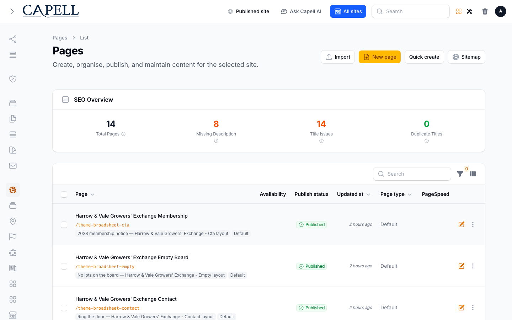
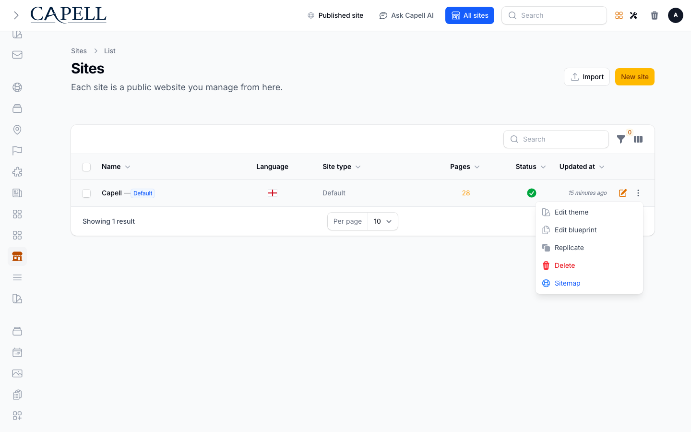

# Site Discovery

<!-- prettier-ignore-start -->

Search engines find your published pages through a sitemap, a file that lists their web addresses, and this keeps that file current whenever editors save or delete pages. Each site also gets a Sitemap page that visitors can read.

A change reaches the sitemap about a minute after it is saved, once background jobs, which your developer or host keeps running, have handled it. A new site gets its first sitemap automatically once it has a domain, and a site without a domain is skipped. Hidden pages and pages marked noindex, a setting that asks search engines to skip a page, are left out. Repeated addresses are dropped, and a new set of sitemap files goes live only after it is checked for damaged or missing files.

This builds on Discovery Foundation, which comes with it. Under the Insights & health menu in the admin, a report lists published pages that are missing from the sitemap or, when a search package is installed, from your site search. Filters narrow it by site or language, and each row gives the reason a page is missing and the next step.

- **Price and availability:** Check current availability and price on the [Capell Marketplace listing](https://capell.app/marketplace/extensions/site-discovery).
- **Licence:** Check the licence terms on the [Capell Marketplace listing](https://capell.app/marketplace/extensions/site-discovery).
- **Requires:** `PHP ^8.4`, `capell-app/admin ^1.0.78`, `capell-app/core ^1.0.79`, `capell-app/discovery-foundation ^1.0`, `capell-app/frontend ^1.0.79`.
- **Install:** `composer require capell-app/site-discovery`.

## Quick Start

1. Install the package: `composer require capell-app/site-discovery`.
2. Open the package admin surface at `/admin/pages` and confirm Site Discovery is available.

## For Developers

URL and discovery-output contracts let packages contribute public records while shared Actions handle deduplication, indexability, sitemap quality, and change notifications.

## Configure

- **Configuration files:** `config/capell-site-discovery.php`.
- **Commands:** `php artisan capell:xml-sitemap`.

## Limits And Pitfalls

- Install the required Capell packages at the versions in `composer.json`: `capell-app/admin ^1.0.78`, `capell-app/core ^1.0.79`, `capell-app/discovery-foundation ^1.0`, `capell-app/frontend ^1.0.79`.
- Review middleware, throttling, signatures, and public-output safety in `routes/web.php` before exposing routes.
- Keep the host Laravel scheduler running so package-registered schedules can execute: `capell:xml-sitemap --incremental (manifest declared)`.
- Keep public Blade and cached HTML free of authoring markers, model IDs, permissions, signed editor URLs, and lazy database queries.
- Custom write integrations must preserve invalidation for `site-discovery` cache tags.

## Screens And Workflow

- Page resource sitemap action (admin).
- Site resource sitemap action (admin).
- Sitemap generation tool (admin).
- Public HTML sitemap page (frontend).
- Generated XML sitemap output (frontend).
- Public URL Registry repair queue (admin).
- Public URL Registry row details (admin).
- Page resource sitemap action with admin sidebar menu open (admin).

## Install Impact

- Required packages: `capell-app/admin`, `capell-app/core`, `capell-app/discovery-foundation`, `capell-app/frontend`.
- Admin navigation: declares `admin-page: PublicUrlRegistryPageContribution`; each Filament page or resource controls its own navigation visibility.
- Admin/editor extensions: none declared.
- Permissions: `View:PublicUrlRegistryPage`; Shield-generated page permissions for `Capell\SiteDiscovery\Filament\Pages\PublicUrlRegistryPage` (names and grants depend on host Shield configuration).
- Public routes: loads `routes/web.php`; registers `SiteDiscoveryFrontendRoutesContribution`.
- Database changes: no package migrations declared.
- Config: `config/capell-site-discovery.php`.
- Settings: no package settings declared.
- Queues or schedules: scheduled commands `capell:xml-sitemap --incremental (manifest declared)`; queue jobs `RebuildAllSitemapsJob`, `RebuildSiteSitemapJob`, `RegenerateSiteSitemapIncrementallyJob`.
- Cache tags: `site-discovery`.
- Commands: `capell:xml-sitemap`.

## Troubleshooting

| Symptom | Likely cause | Check | Fix |
| --- | --- | --- | --- |
| Package surface is missing after install | Provider or manifest is not loaded | Confirm `capell.json`, package `composer.json`, and provider registration | Reinstall the package, refresh Composer autoload, and clear host caches |
| Route returns unexpected output | Route cache, middleware, or signed URL setup does not match the package route file | Check the route files listed in `Technical Shape` | Clear route cache and verify middleware before exposing public routes |
| Background work does not run | Queue worker or declared schedule is not active | Check the jobs and scheduled commands listed in `Technical Shape` | Start the queue worker or host scheduler, then run the focused command or package test |
| Public output leaks unexpected state | Render data, cache variation, or authoring boundary has regressed | Check public Blade, cache tags, and public-output safety tests | Move data loading out of Blade and rerun the package public-output tests |

## Upgrading

No manual steps between minor versions.

Read [CHANGELOG.md](CHANGELOG.md) before upgrading.

## Next Steps

- [Package docs](docs/README.md)
- [Overview](docs/overview.md)
- [Worked extension examples](docs/extension-contracts.md)
- [Admin guide](docs/admin-guide.md)
- Configuration files: [`config/capell-site-discovery.php`](config/capell-site-discovery.php).
- [Troubleshooting](#troubleshooting)
- [Developer reference](docs/reference.md)
- [Marketplace assets](docs/assets/marketplace/)
- [Capell content language plan](../../docs/CONTENT_LANGUAGE_PLAN.md)
- [Capell documentation design system](../../docs/DESIGN_SYSTEM.md)
- [Capell and package ERD notes](../../docs/erd/capell-and-package-erds.md)
- Related packages: [Discovery Foundation](../discovery-foundation/README.md), [Agent Delivery](../agent-delivery/README.md), [Search](../search/README.md), [SEO Checks](../seo-suite/README.md), [Redirects](../url-manager/README.md).

<!-- prettier-ignore-end -->
